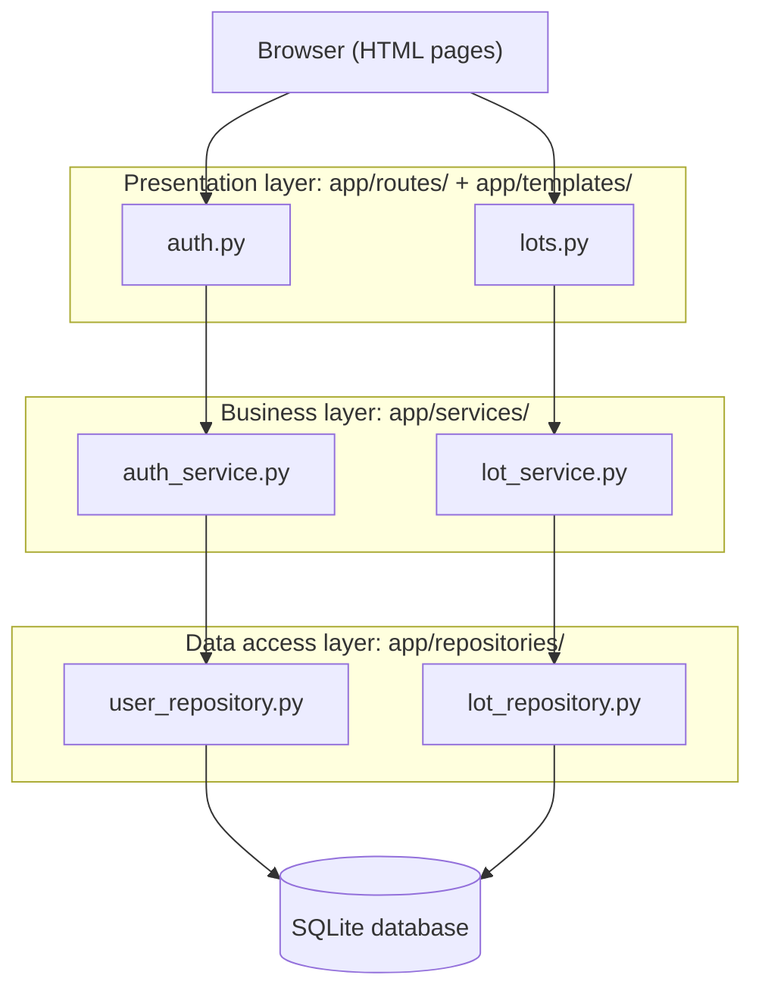

# Architecture

> Reference for your team. You don't need to redraw it, but you do need to follow it:
> the change request is much easier when rules live in services and SQL lives in repositories.

Panther Parking uses a **layered architecture** (Sommerville Ch. 6). Each layer may call only the layer directly below it.

## Rules for each layer

| Layer | May do | May not do |
| --- | --- | --- |
| Routes | Read the request, call one service function, render a template or redirect | Contain business rules or SQL |
| Services | Enforce business rules (validation, status, eligibility) | Touch `request`, `session`, or write SQL |
| Repositories | Run SQL and return plain dicts | Make business decisions |
